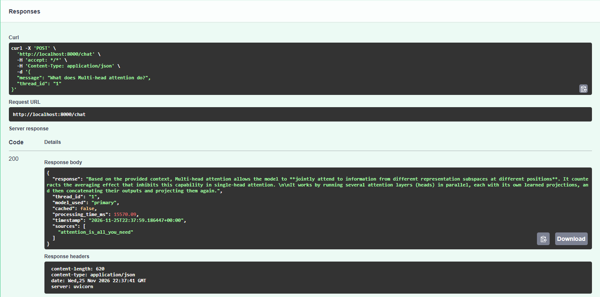

# Production RAG SYSTEM

A retrieval-augmented chat API built with FastAPI and LangGraph. It combines hybrid retrieval and cross-encoder reranking with input/output security filtering, Redis response caching, model fallback, and an evaluation suite that measures retrieval quality, answer correctness and refusal behavior.



## Features

- **Hybrid retrieval:** pgvector similarity search plus Postgres full-text search, merged with Reciprocal Rank Fusion
- **Reranking:** MiniLM cross-encoder (`cross-encoder/ms-marco-MiniLM-L-6-v2`) over 20 candidates, with a timeout that falls back to first-stage ranking
- **Grounded answers:** the model answers only from retrieved context, returns the source documents, and refuses when the context lacks the answer
- **Document ingestion:** upload `.pdf`, `.docx`, `.txt` or `.md` files, or post raw text. Re-ingesting a source replaces its chunks
- **Security:** prompt-injection patterns blocked, PII masked before the LLM and in responses, secrets redacted on output, admin endpoints protected by an API key
- **Reliability:** primary/fallback model chain, Redis cache that fails open, rate limiting
- **Observability:** structured JSON logs, request metrics, LangSmith tracing (masked text only)
- **Evaluation:** 46-question golden set with retrieval metrics (hit@k, MRR) and LLM-judged answer metrics

## Architecture

```
request -> security check -> cache lookup -> [hit: return]
                                  |
                                  v miss
           vector search + keyword search -> RRF merge -> cross-encoder rerank (top 4)
                                  |
                                  v
                   LangGraph agent (primary model, fallback model, error handler)
                                  |
                                  v
                   output validation -> cache store -> response (answer + sources)
```

Stack: FastAPI, LangGraph, PostgreSQL + pgvector, Redis, OpenRouter (LLM and embeddings), sentence-transformers, LangSmith.

## Results

Evaluated on 46 questions over 4 documents: 34 answerable (lookup, paraphrase, table) and 12 unanswerable (plausible-but-absent, cross-document false premise, off-topic).

| Configuration       | hit@1    | hit@3    | hit@20   | MRR      | Answer correct | False refusals |
| ------------------- | -------- | -------- | -------- | -------- | -------------- | -------------- |
| Vector only         | 0.41     | 0.71     | 0.88     | 0.55     | 79%            | 15%            |
| Hybrid only         | 0.47     | 0.71     | 0.97     | 0.61     | n/a            | n/a            |
| Vector + rerank     | 0.76     | 0.88     | 0.91     | 0.82     | 85%            | 6%             |
| **Hybrid + rerank** | **0.82** | **0.94** | **0.97** | **0.88** | **91%**        | **3%**         |

- In every configuration tested at answer level, all 12 unanswerable questions were refused with no fabricated answers.
- Retrieval metrics rerank 30 candidates; answer-level runs use the production setting (20 candidates, top 4 sent to the model).
- A repeated question is served from the Redis cache in about 50 ms, versus about 27 s uncached (free-tier models, CPU-only reranking).

## Quick start

```bash
git clone https://github.com/CodeReader101/production-rag-system.git
cd production-rag-system
cp .env.example .env          # fill in OPENROUTER_API_KEY, ADMIN_API_KEY and the model names
docker compose up --build
curl localhost:8000/health
```

The database starts empty. Put your documents in `data/` and upload them. The filename without its extension becomes the document's `source` (override it with `-F source=...`):

```bash
for f in data/*; do
  curl -X POST localhost:8000/ingest/file \
    -H "x-api-key: $ADMIN_API_KEY" -F "file=@$f"
done
```

Supported types: `.pdf`, `.docx`, `.txt`, `.md` (10 MB max). To post raw text instead:

```bash
curl -X POST localhost:8000/ingest \
  -H "x-api-key: $ADMIN_API_KEY" -H "content-type: application/json" \
  -d '{"source": "nimbus_learning_policy", "text": "..."}'
```

Ask a question:

```bash
curl localhost:8000/chat -H "content-type: application/json" \
  -d '{"message": "What are the customer support hours?"}'
```

Interactive API docs are at `http://localhost:8000/docs`.

To run the API on your machine instead (with only Postgres and Redis in Docker):

```bash
docker compose up -d postgres redis
pip install -r requirements.txt
cd app && uvicorn main:app --port 8000
```

## API

| Endpoint            | Auth                | Purpose                                                    |
| ------------------- | ------------------- | ---------------------------------------------------------- |
| `POST /chat`        | none (rate limited) | Ask a question; returns the answer, sources and model used |
| `POST /ingest`      | `x-api-key`         | Index raw text under a `source` name                       |
| `POST /ingest/file` | `x-api-key`         | Upload a PDF, DOCX, TXT or MD file                         |
| `GET /health`       | none                | Liveness check                                             |
| `GET /metrics`      | `x-api-key`         | Request, latency, token and cache metrics                  |
| `GET /cache/stats`  | `x-api-key`         | Cache hit rate and entry count                             |

## Configuration

Set in `.env` (see `.env.example`):

| Variable                                 | Purpose                                                 |
| ---------------------------------------- | ------------------------------------------------------- |
| `OPENROUTER_API_KEY`                     | LLM and embedding provider key (required)               |
| `ADMIN_API_KEY`                          | Protects ingest, metrics and cache endpoints (required) |
| `PRIMARY_MODEL`, `FALLBACK_MODEL`        | Chat models; the fallback is used if the primary fails  |
| `EMBEDDING_MODEL`                        | Embedding model (changing it requires re-ingesting)     |
| `DATABASE_URL`, `REDIS_URL`              | Overridden automatically in Docker Compose              |
| `RAG_HYBRID`                             | `true`/`false`: enable the keyword search leg           |
| `RERANKER_MODEL`                         | Cross-encoder model; empty disables reranking           |
| `RAG_CANDIDATES`, `RAG_TOP_K`            | Candidates reranked and chunks sent to the model        |
| `LANGSMITH_API_KEY`, `LANGSMITH_TRACING` | Optional tracing                                        |

## Evaluation

The golden set is `eval/golden.jsonl`. Each answerable question has an expected answer and a snippet that must appear in the retrieved chunk; unanswerable questions have no source and must be refused.

```bash
# retrieval metrics (hit@k, MRR), plus an audit that every snippet exists in a single chunk
RAG_HYBRID=1 RERANK=1 python eval/eval.py eval/golden.jsonl my_run

# answer-level metrics judged by an LLM (set JUDGE_MODEL in .env)
RAG_HYBRID=1 RERANK=1 python eval/answer_eval.py eval/golden.jsonl my_run
```

Set `RAG_HYBRID=0` and/or `RERANK=0` to reproduce the other rows of the results table. Output is written to `eval_results/`; `python eval/compare.py run_a run_b` shows which questions changed rank between two runs.

## Tests

```bash
pip install pytest pytest-asyncio httpx
pytest -q
```

The automated tests run offline (no database, Redis or model calls) and cover the security layer, cache failure modes, authentication and the API endpoints.

## Limitations

- The 46-question set was also used while developing the system, so the numbers are optimistic; one answerable question is about 3 points.
- Answer quality is scored by an LLM judge that I spot-checked, not by human review.
- Three questions about one document still fail: one answer ranks below the top-4 cutoff, one list is split across chunks, and one chunk is never retrieved.
- Keyword search uses Postgres full-text ranking, which has no inverse document frequency, so it is not BM25.
- The reranker score cannot separate answerable from unanswerable questions; refusals come from the prompt, tested on only 12 questions.
- One shared corpus (no per-user access control) and no conversation memory: `thread_id` is accepted but unused.
- The PII filter masks every email address and phone-like number in answers, including ones that appear in documents.
- Latency is dominated by free-tier model calls and CPU reranking.
